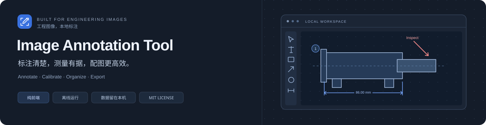
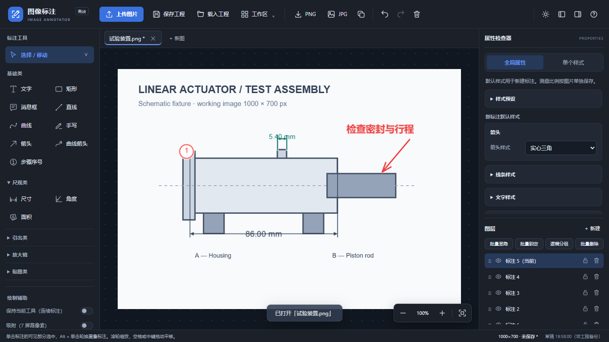
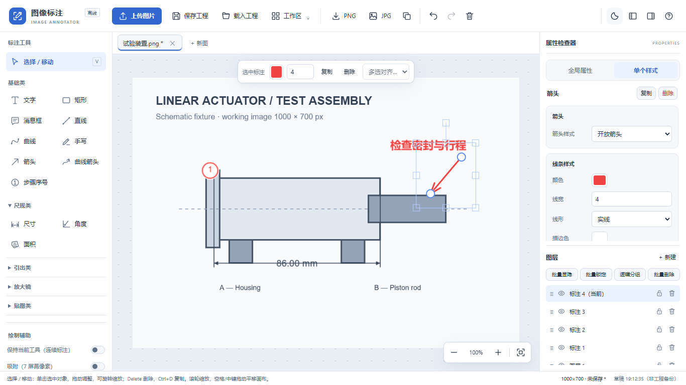
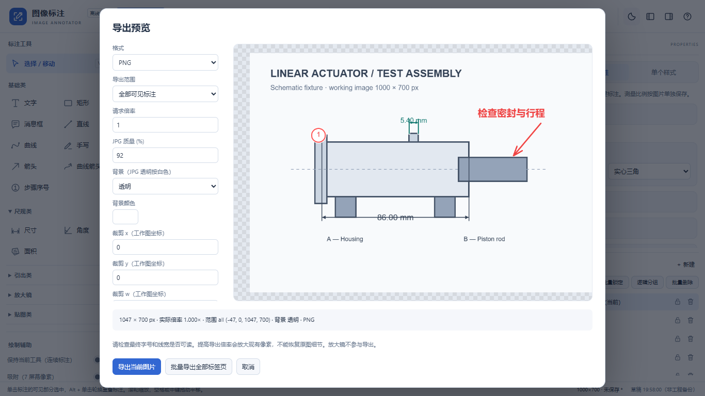

<div align="center">



# 离线图像标注工具

**为机械结构图、液压原理图、试验照片和技术报告配图而做。**

打开一个 HTML 文件，就能标注、测量、管理多张图片并导出配图。
无需安装 · 无需服务器 · 无需联网

[三步开始](#三步开始) · [核心能力](#核心能力) · [界面预览](#界面预览) · [使用说明](使用说明.md) · [反馈问题](https://github.com/bovins/Image-Annotation-Tool/issues)

<picture>
  <source media="(prefers-color-scheme: light)" srcset="docs/editor-light.png">
  <source media="(prefers-color-scheme: dark)" srcset="docs/editor-current.png">
  
</picture>

<sub>真实界面截图 · 演示图由测试代码绘制 · 根据系统配色选择截图</sub>

</div>

## 核心能力

<table>
<tr>
<td width="50%" valign="top">
<strong>✏️ 把问题标注清楚</strong><br><br>
文字、箭头、引出说明、区域圈注和步骤序号，适合结构说明、问题反馈与试验记录。直箭头和曲线箭头支持四种箭头样式，控制点可继续编辑。
</td>
<td width="50%" valign="top">
<strong>📐 用已知尺寸标定比例</strong><br><br>
选择两点，输入距离与单位，即可测量长度、面积和角度。每张图片独立保存比例，几何变换后更新读数。
</td>
</tr>
<tr>
<td valign="top">
<strong>🗂️ 多张图片，一个工作区</strong><br><br>
批量导入、标签重命名、独立历史和视口。工程保存当前图片，工作区保存全部标签，浏览器草稿帮助恢复编辑。
</td>
<td valign="top">
<strong>🎛️ 一套样式，整组配图</strong><br><br>
内置机械尺寸、问题反馈、论文插图预设；支持用户预设、样式复制和离线 JSON 迁移，减少重复调整。
</td>
</tr>
<tr>
<td valign="top">
<strong>🧩 复杂标注也能有条理</strong><br><br>
独立图层、逻辑分组、批量显隐与锁定。搭配连续标注、六种对齐、吸附和快捷操作，整理密集标注。
</td>
<td valign="top">
<strong>🖼️ 看清结果，再导出</strong><br><br>
预览最终像素、范围、背景与质量；支持 PNG/JPG、透明背景、自定义矩形和顺序批量导出。
</td>
</tr>
</table>

**图片留在本机。** 运行时使用本地 Fabric.js 和普通前端脚本，不请求在线服务或字体。浏览器草稿只是恢复副本，请另存工程文件备份。

## 三步开始

### 1 · 下载并打开

在仓库顶部选择 **Code → Download ZIP**，完整解压后双击 **`index.html`**。

```text
Image-Annotation-Tool/
├── index.html  双击打开
├── vendor/     本地 Fabric.js
├── css/        界面样式
└── js/         标注工具与工程逻辑
```

保留以上文件和目录。普通用户**不需要** Node.js、npm、开发依赖或本地服务器。

### 2 · 导入并标注

上传图片、拖入多张图片，或用 **Ctrl+V** 粘贴。右栏「全局属性」设置新标注的默认样式；选中已有标注后，在「单个样式」中修改。

需要测量时，先点击「两点比例标定」，选择已知长度的两端，输入实际距离和单位。

### 3 · 保存工程，导出配图

| 想做什么 | 使用入口 |
| --- | --- |
| 保留当前图片，之后继续编辑 | **保存工程** / `Ctrl+S` |
| 保存全部图片与标注 | **工作区 → 保存工作区** |
| 生成报告或论文配图 | **PNG / JPG** / `Ctrl+E`，预览后导出 |
| 继续已有工作 | **载入工程**，或 **工作区 → 载入工作区** |

导出图片不会清除工程的未保存标记。支持时显示另存为窗口，否则交给浏览器下载，请确认下载文件已保存。

→ [阅读完整使用说明](使用说明.md)

## 界面预览

<table>
<tr>
<th width="50%">明亮主题</th>
<th width="50%">导出预览</th>
</tr>
<tr>
<td><a href="docs/editor-light.png"></a></td>
<td><a href="docs/export-preview.png"></a></td>
</tr>
<tr>
<td>右栏切换全局属性和单个样式，图层独立滚动。</td>
<td>原图范围、全部可见标注或自定义裁剪，预览与输出共用渲染。</td>
</tr>
</table>

选中快捷条浮动显示，不挤动画布；缩放控件固定在右下角，左右面板和低频工具可折叠。

<details>
<summary><strong>查看完整工具列表</strong></summary>

| 类别 | 工具 |
| --- | --- |
| 基础标注 | 文字、矩形、消息框、直线、曲线、手写、箭头、曲线箭头、步骤序号 |
| 尺规测量 | 尺寸、三点角度、多边形面积、两点比例标定 |
| 引出说明 | 文字引出、引出区域、图引出、多引出 |
| 视图与遮盖 | 圆形/方形放大镜、表情/图片贴图、马赛克与橡皮擦 |
| 编辑辅助 | 控制点、旋转缩放、多选对齐、吸附、连续模式、样式预设与复制 |

放大镜仅用于编辑查看，不参与图片导出。

</details>

## 常用快捷键

| 按键 | 操作 |
| --- | --- |
| `Ctrl+Z` / `Ctrl+Y` / `Ctrl+Shift+Z` | 撤销 / 重做 |
| `Ctrl+S` / `Ctrl+E` | 保存工程 / 导出预览 |
| `Ctrl+D` / `Delete` | 复制 / 删除选中标注 |
| `Ctrl+Shift+C` / `Ctrl+Shift+V` | 复制 / 粘贴兼容样式 |
| `V` / `Esc` | 选择工具 / 取消当前操作 |
| 方向键 / `Shift` + 方向键 | 微调 1 / 10 工作图像素 |
| 空格拖动 / 中键拖动 | 平移画布 |
| `Shift` 绘制 | 45° 倍角直线、箭头、尺寸；等比例矩形、消息框 |
| `Enter` / 右键 | 完成面积、多引出 |

文字输入和中文输入法组合期间不拦截标注快捷键。顶栏「快捷键说明」可随时查看操作。

## 工程、草稿与兼容性

| 保存内容 | 用途 |
| --- | --- |
| 单图工程 JSON | 图片、标注、图层、马赛克、比例与视口，便于继续编辑 |
| 多图工作区 JSON | 全部标签页及当前页位置，便于整组图片管理 |
| 用户预设 JSON | 仅传递样式，便于离线电脑之间迁移 |
| IndexedDB 草稿 | 本浏览器的自动恢复副本，启动时选择恢复或丢弃 |

当前单图工程版本 2，可读取旧版 1；工作区和预设版本均为 1。载入工程/工作区时先校验，再追加标签页。

- **大图处理：** 新图片超过最大边 4096 会实际重采样并提示前后尺寸，保留透明度；标注、取样与测量使用工作图坐标。
- **测量范围：** 普通照片的透视和镜头畸变会影响精度，本工具不进行透视校正；提高导出倍率不能恢复原图细节。
- **浏览器目标：** Chrome 109、Edge 109、Firefox 115 ESR。当前真实浏览器验证使用 Windows Edge 的 `file://`，不等同于旧版本全部实测。
- **草稿边界：** 清理浏览数据、切换浏览器或移动网页路径可能使草稿不可用；`file://` 的存储和下载能力受浏览器策略影响。

→ [查看修复、测试与人工验收记录](docs/修复与验证.md)

## 开发与验证

<details>
<summary><strong>展开测试命令与开发说明</strong></summary>

原有 Node 模拟测试无需安装依赖：

```sh
node test-verify.js
node test-render.js
node test-tools.js
node test-app-smoke.js
```

真实浏览器回归需要 Node 18+、开发依赖和本机 Edge：

```sh
npm ci
npm test
npm run test:browser
```

其他验证入口：

```sh
node tests/baseline.js      # 隔离回放原提交中的缺陷
node tests/screenshots.js   # 生成真实界面截图
```

Playwright 1.56.1（Apache-2.0）仅用于开发，不是离线运行的前置条件。DOM 模拟和真实浏览器分别报告；测试证据与兼容性限制记录在[验证文档](docs/修复与验证.md)中。

</details>

<details>
<summary><strong>展开代码结构</strong></summary>

| 文件 | 职责 |
| --- | --- |
| `js/objects.js` | Fabric 标注类、内容坐标重排、变换后测量 |
| `js/tools.js` | 绘制、控制点、标定、约束和马赛克 |
| `js/resources.js` | 像素重采样、内嵌底图、资源解码、文件名 |
| `js/project-store.js` | 文件版本与校验、资源预检、IndexedDB |
| `js/app.js` | 历史事务、标签状态、工程/工作区流程、属性面板 |
| `js/export-renderer.js` | 导出边界、最终像素限制、隔离渲染 |
| `js/efficiency.js` | 预设、样式传递、吸附和右键菜单 |
| `js/export-ui.js` | 导出预览与顺序批量导出 |
| `js/ui.js` / `js/icons.js` | 面板与快捷条、本地界面图标 |

沿用 Fabric.js 5.5.2；没有框架迁移、在线运行时依赖或在线字体。

</details>

## 反馈与参与

欢迎通过 [Issues](https://github.com/bovins/Image-Annotation-Tool/issues) 反馈问题或提出改进。报告问题时请附上操作步骤、浏览器版本，以及经过脱敏的示例工程或截图。

提交代码前请运行相关测试；功能和界面变更请说明验证方式。

---

<div align="center">

**让结构说明、试验记录和技术配图更清晰。**

[完整说明](使用说明.md) · [验证记录](docs/修复与验证.md) · [MIT 许可证](LICENSE)

Copyright © 2026 bovins · Fabric.js 的许可证声明保留在本地 vendor 文件中。

</div>
