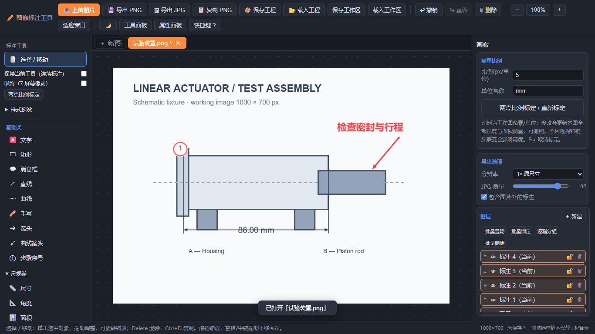
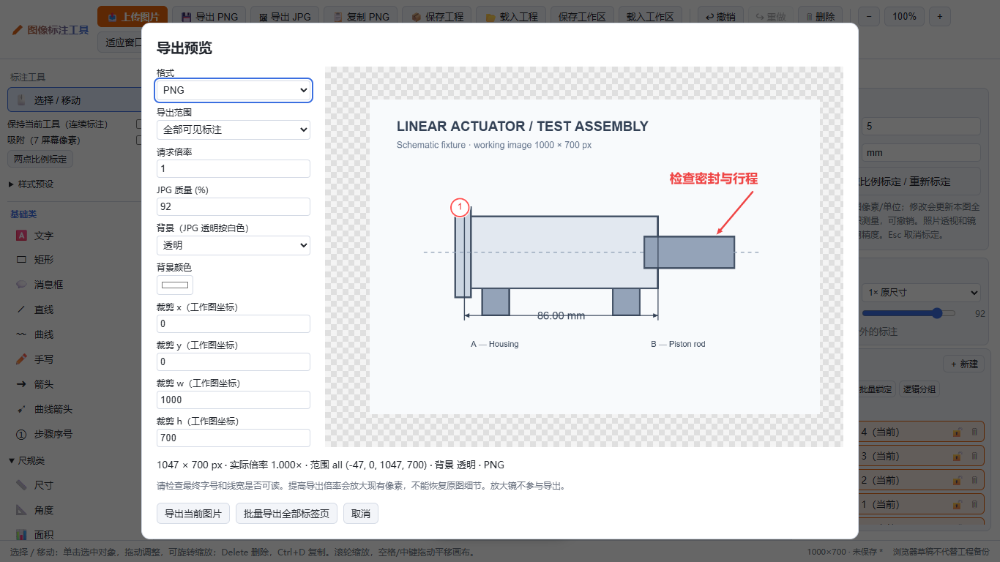

# 修复与验证记录

日期：2026-11-04。基线：`219fd39585e5c0b50b6a18c5c95ef70591504289`，拉取时的主分支与此提交一致；未发现 AGENTS.md、GLOSSARY.md 或相关 ADR。
工作分支：`fix/offline-reliability-workflow`。主分支未合并。

## 七项缺陷

| 缺陷 | 基线复现与根因 | 修复与验证结论 |
| --- | --- | --- |
| 工程无法保存 | 真实 Edge 上传后保存，抛 `CV._baseImgEl.toDataURL is not a function`。HTMLImageElement 不提供 Canvas API，原测试错误添加此方法 | 工作底图重采样到离屏 Canvas，工程内嵌 PNG；贴图同样转换像素源，避免保存撤销的 blob URL。序列化/写入异常明确提示，取消不清除未保存标记；另存为与下载降级保留。实际下载及底图、标注、图层、马赛克、比例和视口往返通过 |
| 移动后改样式跳位 | 真实 Edge 在平移、旋转、缩放后的线条改颜色，内容点跳回旧位置。`_offX/_offY` 被当作对象 left/top，且 `||` 吞掉 0 | 共享 AnnotationGeometry：内容原点经完整仿射矩阵映射到父/世界坐标，重排后按新包围盒补偿中心。应用于属性、全局样式、控制点结束、文字等比缩放。非等比/斜切保留变换。零/负坐标、旋转、缩放、既有控制点回归通过 |
| 大图尺寸不一致 | 真实 Edge 上传 8000×6000，逻辑 4096×3072、Fabric 与自然像素仍是 8000×6000 | 真正重采样，像素源、Fabric 和逻辑尺寸一致，提示前后尺寸，保留透明度。实际核对图引出裁剪与马赛克同点像素，长图最短边不为零。旧工程自然/逻辑尺寸不一致时迁移并提示 |
| 快速撤销错误 | 隔离原提交中，文字编辑后立即撤销会删除文字对象。防抖尚未入栈，旧计时器可继续写入 | 撤销/重做/切图/关闭/事务前处理待提交编辑，计时器绑定标签身份；连续输入合并。异步图片/马赛克恢复完成前串行处理切换。快速撤销后等待再重做、多图隔离及恢复中切换通过 |
| 测量缩放读数不变 | 真实 Edge 中 10px 对象放大两倍、比例 1、单位 mm 仍显示 `10 px` | 长度用完整变换的向量，面积乘行列式绝对值，角度用变换后两向量，视口不参与测量。比例 1 显示 mm/mm²。标签边界包含测量文字。等比、非等比、旋转和非法比例检查通过 |
| 隐藏放大镜重现 | 隔离原提交，圆/方放大镜从 visible=false 经 refresh/export 变为 true；原逻辑无条件恢复 true | 快照记录原显隐并在 finally 恢复；新导出渲染直接排除放大镜，无需修改显隐。两种放大镜隐藏状态及快照异常通过；独立导出不改主画布视口/尺寸/选择 |
| 复制共用图层 | 隔离原提交，文字复制前后 layerId 相同；`new klass(data)` 也不能普遍用于图片/路径 | 使用 Fabric clone/fromObject，复制前记录世界矩阵，保留多选旋转/缩放并加世界偏移。每副本独立图层，整次复制一个历史步骤，失败提示。单/多选、图片贴图内嵌资源及复制后工程往返通过 |

最初四项 Node 模拟测试全部通过，但真实浏览器仍复现保存/尺寸/样式/测量问题。修复了全局 Image 模拟及 createElement('img') 上不存在的 Canvas 方法。
原提交的历史、放大镜、复制回放脚本为 `tests/baseline.js`，生成到忽略的 `test-results/baseline/`，只额外暴露私有函数，不改变被测算法或当前源码。

## 阶段与实现

1. 可靠性：统一工作图像素与坐标，修复保存、重排、历史、测量、显隐、复制；先验证原测试和真实浏览器的核心失败路径。
2. 工程管理：每图未保存指纹、撤销回保存状态、内部关闭和原生离开提醒；IndexedDB 草稿防抖、恢复/丢弃及失败提示；单图 v1→v2 校验迁移、工作区 v1 追加载入，资源预检后才修改打开内容。
3. 效率：两点比例预览/取消/重标定与统一测量更新；连续模式和偏好；三种内置及用户预设、JSON 迁移、兼容样式复制；顺序批量导入、标签命名；图层选择/批量/逻辑组；对齐、Shift 约束、屏幕容差吸附和右键菜单。
4. 导出/界面：统一隔离渲染和范围描述驱动预览、输出与复制；原图/全标注/自定义矩形、透明/实色、JPG 质量、最终像素限制；顺序批量导出和重名处理；面板折叠、快捷条、工具类别收纳、焦点和减少动态效果。

运行时仍为本地 Fabric.js + 普通脚本，无框架迁移和在线依赖。Playwright 1.56.1 是开发依赖（Apache-2.0）；普通用户不需要 npm 或浏览器测试包。没有新增 PDF/SVG/ZIP 导出。
新模块职责见 README。使用方式见使用说明。图层逻辑组不改变 Fabric 几何；历史与标签状态仍由 app.js 统一协调，避免多套互相矛盾的序列化。

## 实际测试

环境：Windows、Node v24.18.0、Playwright 1.56.1、本机 **Microsoft Edge 156.0.4314.58**，headless 模式。

| 命令 | 类型 | 结果 |
| --- | --- | --- |
| `node test-verify.js` | Node DOM/Canvas 模拟，对象 API | 通过，0 失败 |
| `node test-render.js` | Node 模拟渲染、序列化、控制点 | 通过，0 失败 |
| `node test-tools.js` | Node 模拟工具交互 | 通过，0 失败 |
| `node test-app-smoke.js` | Node 模拟启动、标签、历史、面板 | 通过，0 失败 |
| `node tests/browser.js` | 真实 Edge，直接 file://，主测试页 HTTP/HTTPS 被阻断 | 34 组通过 |
| `node tests/baseline.js` | 真实 Edge 隔离回放原提交 | 历史、圆/方放大镜、复制共用图层均确认复现 |
| `node tests/screenshots.js` | 真实 Edge 截图 | 1366×768 编辑器明/暗主题、导出预览，已人工查看布局 |
| `git diff --check` | 补丁空白检查 | 通过 |

浏览器测试覆盖：上传/保存下载/重载；平移旋转缩放后重排；大图像素/裁剪/马赛克/透明度；快速撤销重做、跨标签和恢复中切换；测量缩放与单位、标定预览/取消/撤销和非法比例；放大镜显隐和异常；多选及图片克隆；保存取消/写入失败/撤销回保存状态；真实 file:// IndexedDB 草稿读写、启动恢复/丢弃、损坏和权限失败降级；工作区往返；连续工具；预设实际 JSON 下载和导入；图层批量操作；Shift/吸附/IME；图片外隔离导出；JPG 下载解码对照预览尺寸与背景；批量文件名清理去重；布局、折叠、帮助和减少动态效果。

文件选择器成功/取消/写入错误使用浏览器内 API 桩测试不同结果，不声称操作了真实操作系统另存为窗口。浏览器下载、图片解码、Canvas 像素、IndexedDB 和页面离开对话框使用真实能力。
原四项测试是模拟测试，不作为浏览器兼容性证据。

截图使用由测试代码绘制的装置示意图，不含用户工程数据。

## 限制与人工验收

- 未安装 Chrome 109、Edge 109、Firefox 115 ESR，不能宣称旧版全部通过。兼容目标保持不变；请在这些实际版本复核 file://、字体、存储、原生保存/下载权限和鼠标控制点。
- 测了 1366×768，以及 1093×614 CSS 视口配 deviceScaleFactor 1.25 的布局；后者不等同于真实 Windows 系统 125% 缩放，仍需人工验证。
- 未进行真实硬盘满、杀进程/断电、企业策略、多窗口长期并发和真实中文输入法人工操作；自动化注入写入/权限错误并测试 composition 标记，只能证明对应降级分支。
- IndexedDB 草稿按同一浏览器/网页路径使用；可能被清理或受限。多个窗口采用最后一次完成写入的草稿，不提供跨窗口合并。手动工程文件必须另行备份。
- 浏览器下载降级无法获知最终写盘或用户在下载界面取消；批量下载可能被浏览器拦截，需允许多文件下载。系统另存为实际文件写入仍需人工验收。
- 旧工程中已撤销的 blob 图片本身无法从文件恢复，会明确列为未恢复资源。新上传底图与贴图均存为像素数据，避免继续生成此类工程。
- 旧工程迁移按所记录的逻辑尺寸重采样；旧错误已经造成的几何/比例偏差不能自动推断，载入时提示核对。
- 导出最多边长 8192、总像素 3200 万；工作区最多 100 图、每工程最多 10000 标注，防止明显异常数据导致无界分配。大批量原图仍会占用浏览器内存，按实际设备容量操作。
- 测量不包含透视校正、镜头畸变补偿或计量认证；导出倍率不恢复原图细节。

以上为尚未实机验证或浏览器固有限制，不用按钮存在或模拟测试结果代替验收。
